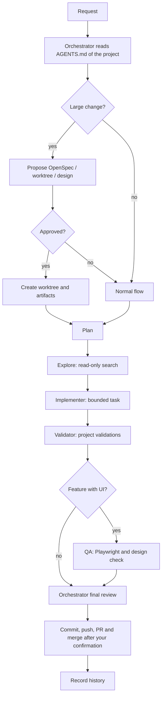

# jdev-ai

A lightweight, stack-agnostic harness of shared rules and workflows for working with AI coding agents across several independent projects.

[Español](README.es.md)

Built by Jorge González Azpillaga, a senior front-end developer focused on agent-driven development.

## Why it exists

When you work on several projects with several coding agents, the same questions keep coming back. When should the agent delegate? How do you resume a project after a week away? When does a change deserve a spec? How do parallel sessions avoid overwriting each other? The answers should not be copied into every repository, and they should not depend on one vendor's CLI.

`jdev-ai` holds those answers once:

- **The harness defines how agents work.** Each repository in `projects/<name>/` defines its own domain, code, dependencies, documentation and validation.
- **It is not a monorepo or a workspace.** Every project keeps its own `.git` and keeps working if the harness disappears. `projects/` is ignored by the harness Git.
- **It imposes no stack, package manager or architecture.** The project's own `AGENTS.md` takes precedence over the global instructions.

## Key features

- **Multi-agent launcher.** `bin/agent` opens a project with Claude Code (default), Codex, Copilot or OpenCode, and shows a "where did I leave off" summary at session start. It adds no configuration files to your projects.
- **Orchestration and delegation.** The main agent acts as orchestrator and delegates bounded work to subagents. The policy is provider-agnostic ([`rules/delegation.md`](rules/delegation.md)); if a tool has no compatible subagents, the main agent plays the roles sequentially. Roles defined for Claude Code in [`adapters/claude/agents.json`](adapters/claude/agents.json):

  | Subagent | Model | Role |
  | --- | --- | --- |
  | `Explore` | Haiku | Read-only search and reading across the repository |
  | `implementer` | Sonnet | The only subagent allowed to write; one bounded task at a time |
  | `validator` | Haiku | Runs the project's validations and reports only failures and their cause |
  | `qa` | Sonnet | End-to-end QA in the browser with Playwright, before a feature is closed |

  Codex gets an equivalent implementer from [`adapters/codex/implementer.toml`](adapters/codex/implementer.toml), injected by the launcher.
- **Context-window and token economy.** The orchestrator keeps the conversation and the decisions; cheaper models do the bulk reading and the bounded implementation. Subagents return a compact result (conclusions, validations, risks), not intermediate traces or full logs. The delegation rule also says not to delegate trivial work, because each subagent has its own cost and does not share the main session's cache. A hook announces each delegation with the subagent, model and reason.
- **Project continuity.** Per project, local iteration summaries in `.agent/history/` (git-ignored) let you resume days later, and an optional `.agent/memory/` keeps durable knowledge that is expensive to rediscover (bug causes, workarounds, discarded approaches). Both are auxiliary: `AGENTS.md`, OpenSpec, official docs, code and Git win on any conflict.
- **Worktrees per feature.** Large changes are isolated in a Git worktree with its own `feat/<name>` branch. After one confirmation to start and one to integrate, the same session creates the worktree, implements, pushes the branch, opens the Pull Request, merges it after the GitHub checks pass, and cleans up (`bin/worktree`). This lets several sessions work on one project without colliding.
- **Optional OpenSpec, with prior approval.** The agent decides whether a change warrants spec-driven development ([`workflows/feature.md`](workflows/feature.md)). If so, it proposes OpenSpec and waits for explicit approval before installing, initializing or creating any artifact. Small, reversible changes follow the normal flow.
- **Backlog, user guides and images.** Future work is recorded in the project's `docs/backlog/` only after you confirm; didactic guides go in `docs/user-guides/`; the agent proposes generating missing images (via Codex) but never does so without confirmation.
- **Design first.** For non-trivial interface changes, the agent proposes closing the designs in Claude Design before implementing, and the approved design becomes the reference for implementation and QA.
- **Autonomous close.** `/goal Close` (or "Continúa hasta dar esta conversación por closed") makes the agent work without asking until everything is done: validated, integrated into the main branch, worktree removed and the session titled `[Closed]`. It still asks before dangerous or destructive actions ([`rules/closed-goal.md`](rules/closed-goal.md)).
- **Self-validation.** `bin/check` tests the launcher and helper scripts against a temporary harness with simulated agents. It launches no real agent and does not touch `projects/`.

## Typical flow



OpenSpec, worktrees and the design proposal each need your approval. Commits, pushes and merges happen only when you ask or confirm (or under `/goal Close`). Delegation is skipped for trivial tasks.

## Repository layout

```text
AGENTS.md        Global instructions every agent reads
CLAUDE.md        Entry point for Claude Code (imports AGENTS.md)
rules/           Shared policies: delegation, worktrees, history, memory,
                 backlog, user guides, images, design, session title, close
workflows/       Common processes (feature.md: OpenSpec, worktree and design proposals)
adapters/        Per-provider subagent definitions (claude, codex)
bin/             agent, check, worktree, session-status, session-title,
                 subagent-notice
openspec/        Specs and changes of the harness itself
projects/        Your projects, one Git repository each (ignored by this repo)
```

## Quick start

Requirements: a POSIX shell, Git, and the CLI of the agent you want to use (`claude`, `codex`, `copilot` or `opencode`) available in `PATH`. Add `gh` for the Pull Request flow of worktrees.

1. Clone the harness and move or clone a project into `projects/`, keeping its `.git`:

   ```sh
   git clone https://github.com/Jgonaz/jdev-ai.git
   cd jdev-ai
   git clone <your-repo-url> projects/my-project
   ```

2. Create or adapt the project's `AGENTS.md` with its own context and rules (stack, commands, validations).
3. Launch an agent:

   ```sh
   bin/agent my-project              # Claude Code by default
   bin/agent my-project --codex      # or --claude, --copilot, --opencode
   bin/agent my-project --wt login   # open (or resume) the "login" worktree
   bin/agent my-project -- resume    # arguments after -- go to the agent as-is
   ```

   Optionally add `bin/` to your `PATH` to use `agent` from anywhere.
4. To use the QA subagent, add a `## QA` section to the project's `AGENTS.md` (start command, test data, what is safe in development). It also needs Node and the Playwright MCP browser; see the Spanish README for details.

Opt-in per-project features (`.agent/memory/`, `docs/backlog/`, `docs/user-guides/`) are created only when relevant. The full reference for every feature is in [`README.es.md`](README.es.md) and in [`rules/`](rules/).

To validate changes to the harness itself:

```sh
bin/check
```

## Language note

The rules, workflows and instructions are written in Spanish (Spain) by design, and agents reply in Spanish by default unless a project's `AGENTS.md` says otherwise. This README is a summary in English; the Spanish [`README.es.md`](README.es.md) is the complete reference.

## License

MIT. See [LICENSE](LICENSE).
