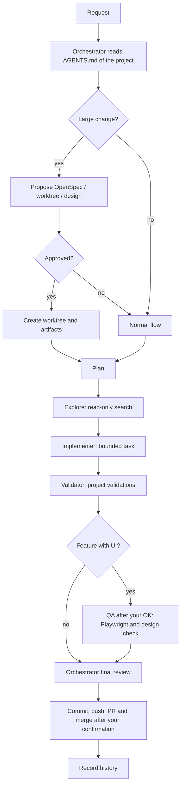

# jdev-ai

A lightweight, stack-agnostic harness of shared rules and workflows for working with AI coding agents across several independent projects.

[Español](README.es.md)

Built by Jorge González Azpillaga, a senior front-end developer focused on agent-driven development.

## Why it exists

When you work on several projects with several coding agents, the same questions keep coming back. When should the agent delegate? How do you resume a project after a week away? When does a change deserve a spec? How do parallel sessions avoid overwriting each other? The answers should not be copied into every repository, and they should not depend on one vendor's CLI.

`jdev-ai` holds those answers once:

- **The harness defines how agents work.** Each repository in `projects/<name>/` defines its own domain, code, dependencies, documentation and validation.
- **It is not a monorepo or a workspace.** Every project keeps its own `.git` and keeps working if the harness disappears. `projects/` is ignored by the harness Git.
- **It imposes no stack, package manager or architecture.** The project's own `AGENTS.md` takes precedence over the global instructions.

## Key features

- **Multi-agent launcher.** `bin/agent` opens a project with Claude Code (default), Codex, Copilot or OpenCode, and shows a "where did I leave off" summary at session start. It adds no configuration files to your projects.
- **Orchestration and delegation.** The main agent acts as orchestrator and delegates bounded work to subagents. The policy is provider-agnostic ([`rules/delegation.md`](rules/delegation.md)); if a tool has no compatible subagents, the main agent plays the roles sequentially. Roles defined for Claude Code in [`adapters/claude/agents.json`](adapters/claude/agents.json):

  | Subagent | Model | Role |
  | --- | --- | --- |
  | `Explore` | Haiku | Read-only search and reading across the repository |
  | `implementer` | Sonnet | The only subagent allowed to write; one bounded task at a time |
  | `validator` | Haiku | Runs the project's validations and reports only failures and their cause |
  | `qa` | Sonnet | End-to-end QA in the browser with Playwright, before a feature is closed |

  Codex gets an equivalent implementer from [`adapters/codex/implementer.toml`](adapters/codex/implementer.toml), injected by the launcher.
- **Context-window and token economy.** The orchestrator keeps the conversation and the decisions; cheaper models do the bulk reading and the bounded implementation. Subagents return a compact result (conclusions, validations, risks), not intermediate traces or full logs. The delegation rule also says not to delegate trivial work, because each subagent has its own cost and does not share the main session's cache. A hook announces each delegation with the subagent, model and reason.
- **Project continuity.** Per project, local iteration summaries in `.agent/history/` (git-ignored) let you resume days later, and an optional `.agent/memory/` keeps durable knowledge that is expensive to rediscover (bug causes, workarounds, discarded approaches). Both are auxiliary: `AGENTS.md`, OpenSpec, official docs, code and Git win on any conflict.
- **Worktrees per feature.** Large changes are isolated in a Git worktree with its own `feat/<name>` branch. After one confirmation to start and one to integrate, the same session creates the worktree, implements, pushes the branch, opens the Pull Request, merges it after the GitHub checks pass, and cleans up (`bin/worktree`). This lets several sessions work on one project without colliding.
- **Optional OpenSpec, with prior approval.** The agent decides whether a change warrants spec-driven development ([`workflows/feature.md`](workflows/feature.md)). If so, it proposes OpenSpec and waits for explicit approval before installing, initializing or creating any artifact. Small, reversible changes follow the normal flow.
- **Backlog, user guides and images.** Future work is recorded in the project's `docs/backlog/` only after you confirm, landing in `backlog/` until you move it to `todo/`, with a YAML header and a short plain-language summary; didactic guides go in `docs/user-guides/`; the agent proposes generating missing images (via Codex) but never does so without confirmation.
- **Design first.** For non-trivial interface changes, the agent proposes closing the designs in Claude Design before implementing, and the approved design becomes the reference for implementation and QA.
- **Autonomous close.** `/goal Close` (or "Continúa hasta dar esta conversación por closed") makes the agent work without asking until everything is done: validated, integrated into the main branch, worktree removed and the conversation marked as done with `bin/session-done`. It still asks before dangerous or destructive actions ([`rules/closed-goal.md`](rules/closed-goal.md)).
- **Graphical panel.** `bin/panel` serves a local web panel (127.0.0.1, token-protected) that gathers the agent terminals of every project: a Home screen that greets you and shows what needs your attention (sessions waiting for you with the agent's notice, conversations marked as done, open pending items from each project's latest entry), project cards sorted by activity with backlog and worktree counts, and recent history, and a "your activity" section with tokens, sessions, responses, active hours, a 12-week calendar and breakdowns by project, model, subagent and tool, computed locally and read-only from the Claude Code transcripts (`~/.claude/projects/`) and Codex sessions (`~/.codex/sessions/`) with a rebuildable cache in `~/.cache/jdev-ai/panel/` (hide it in Settings); sessions grouped by project with title and state (waiting for you, working, idle, done), one/two/four-column layouts, a new-session dialog that runs `bin/agent`, and theme, font, terminal, notification (with a choice of synthesized sounds, or the Windows ones from `C:\Windows\Media` under WSL, for a waiting and a finished session), name and start-screen settings. Terminals live in a dedicated tmux server (`tmux -L jdev`), so they survive closing the browser. A Projects menu leads to three screens: Backlog (each project's backlog by state, with filters, item details, state moves via `git mv` left uncommitted, and a "Work on this" shortcut that opens a new session with a prompt), Worktrees and Guides. Side panels can be resized with the mouse; sessions and tabs have a right-click menu (open, rename, copy the attach command, mark as done or reopen, close the tab, end the session; past conversations can be marked as done too, shown with a check and the word "Hecha" and a tooltip saying when and by whom, and a "Hide done" filter hides them); live sessions without a tab are listed as running in the background; hovering a sidebar row shows a tooltip with the full title, place and agent (plus model, context bar, time and running work for a live Claude session); "Archive" in the context menu moves a session or past conversation to a collapsible "Archived" section without ending it (saved in `~/.config/jdev-ai/archived.json`; a waiting archived session still counts in the alerts and Home, other archived sessions do not; archived conversations do not use up the "Previous" limit and resuming one unarchives it); Worktrees opens on the first project with open worktrees; each terminal has a scroll bar over the tmux history, and Claude Code runs with its classic renderer inside the panel so that history stays in tmux. A History screen gathers the `.agent/history/` entries of every project and the harness by day, with project, state and "only with pending for you" filters (latest entry of each project, optionally including older ones), a reader that highlights "Pendiente de ti", pending items you can mark as done in the entry itself (`- [x] … (hecho YYYY-MM-DD)`, then hidden from the start-up summary), a confirmed bulk action that marks the pending items of older entries as done, and a "Resume from here" shortcut. Recent Claude Code sessions opened elsewhere can be resumed inside the panel (`--resume`) once you close their original window. A "Terminal (no agent)" choice in the new-session dialog (and in the default-agent menu) opens a plain login shell (`$SHELL -l`) in a project or existing-worktree folder to run commands or servers: it has a terminal icon instead of a status light and does not count in alerts or in Home. A ▶ / ■ button next to each project's "+" starts its dev server in such a terminal titled "dev · <project>" (the project's own command from Settings › Projects, or the `dev` script of its `package.json` run with the package manager its lockfile or `packageManager` indicates), which keeps running in the background after closing its tab; ■ sends Ctrl+C and ends the session, and there is at most one per project. Image paths printed in a terminal open in a side viewer, and images can be pasted or dropped onto a terminal to hand them to the agent. Each terminal header shows the Claude session's model, effort, context bar (amber from 50 %, red from 80 %), branch or worktree, session time and any running work (subagents, background shells, published artifacts), and the global header shows the default agent for new sessions, a keyboard button that opens a cheatsheet of every keyboard shortcut, and the account's 5-hour and 7-day limits; this data comes from a Claude statusline and hooks that `bin/agent` installs only in panel sessions (your own statusline is untouched in a plain terminal). Because Claude gets no clicks in classic mode, the subagents and background shells in a header chip's dropdown open as read-only follow tabs (eye icon, next to the terminal tabs, in 1, 2 and 4 columns): a subagent shows its task, each tool call ("Leo", "Busco", "Edito", "Ejecuto"…) with its result (red on failure), its messages and its final result, without its reasoning; a shell shows its command and the last 2,000 lines of output as plain text; both update live with "Follow the end" ("Seguir al final") and stay open as "Terminado" when they finish (read from Claude's own transcript and task-output files, only the user's files inside Claude's folders). Each Claude terminal header also has a "Terminal / Chat" switch, remembered per tab. The chat view is built from the session transcript and shows your messages, Claude's replies in sanitized Markdown, and consecutive tool calls grouped in a collapsed dropdown with their results and errors. Search (the magnifier or Ctrl+F) covers the whole conversation, including tool results, ignoring case and accents. A message box pastes your text into the tmux session as one bracketed paste, so line breaks do not submit early, then presses Enter. Claude Code commands (`/goal close`, `/compact`…) show as a monospaced message of yours with their local output dimmed below, and are searchable. `/btw question` is answered by Claude in a terminal window and never stored in the transcript: the panel reads the answer from the window's visible text (if it does not fit, it scrolls the window with the Down key and joins the screens; if it cannot confirm it reached the end, it says so), closes the window with Escape and shows it in the chat, as preformatted text (the terminal UI already lays it out), as a separate "Pregunta al margen" block that is not part of the conversation and, living only in the browser, disappears when the panel is reloaded. The panel never presses `c` in that window (Claude would also copy with the system's native tool and overwrite your clipboard), so your clipboard is left alone. If a Claude window or menu is open in the terminal (the `/btw` window, a selector such as `/model`, a permission dialog), the chat does not send the message, because it would be lost or answer the dialog: it keeps your text and asks you to close it in the terminal, and a command that opens a menu is flagged as waiting in the terminal. Permissions and menus are still answered in the terminal, and the chat shows a "Go to the terminal" notice when Claude is waiting for one. The terminal stays connected while you view the chat. The switch is disabled, with the reason, in Codex sessions and plain terminals. Agents know whether you are in the panel or a plain terminal (`JDEV_SURFACE`, [`rules/surface.md`](rules/surface.md)). Requires Node 24, pnpm, tmux and a C/C++ toolchain for `node-pty`; run `pnpm --dir panel install` once. It can be installed as an app (PWA) from Chrome or Edge, or opened in a Chrome app window with `bin/panel --app` (`JDEV_PANEL_BROWSER=msedge` for Edge).
- **Self-validation.** `bin/check` tests the launcher and helper scripts against a temporary harness with simulated agents. It launches no real agent and does not touch `projects/`.

## Typical flow



OpenSpec, worktrees and the design proposal each need your approval. Commits, pushes and merges happen only when you ask or confirm (or under `/goal Close`). Delegation is skipped for trivial tasks.

## Repository layout

```text
AGENTS.md        Global instructions every agent reads
CLAUDE.md        Entry point for Claude Code (imports AGENTS.md)
rules/           Shared policies: delegation, worktrees, history, memory,
                 backlog, user guides, images, design, session title, session done, close
workflows/       Common processes (feature.md: OpenSpec, worktree and design proposals)
adapters/        Per-provider subagent definitions (claude, codex)
bin/             agent, check, worktree, panel, session-status, session-state,
                 session-statusline, session-activity, session-title, session-done,
                 subagent-notice
panel/           Graphical panel (Node + React), the only part with dependencies
openspec/        Specs and changes of the harness itself
projects/        Your projects, one Git repository each (ignored by this repo)
```

## Quick start

Requirements: a POSIX shell, Git, and the CLI of the agent you want to use (`claude`, `codex`, `copilot` or `opencode`) available in `PATH`. Add `gh` for the Pull Request flow of worktrees.

1. Clone the harness and move or clone a project into `projects/`, keeping its `.git`:

   ```sh
   git clone https://github.com/Jgonaz/jdev-ai.git
   cd jdev-ai
   git clone <your-repo-url> projects/my-project
   ```

2. Create or adapt the project's `AGENTS.md` with its own context and rules (stack, commands, validations).
3. Launch an agent:

   ```sh
   bin/agent my-project              # Claude Code by default
   bin/agent my-project --codex      # or --claude, --copilot, --opencode
   bin/agent my-project --wt login   # open (or resume) the "login" worktree
   bin/agent my-project -- resume    # arguments after -- go to the agent as-is
   ```

   Optionally add `bin/` to your `PATH` to use `agent` from anywhere.
4. To use the QA subagent, add a `## QA` section to the project's `AGENTS.md` (start command, test data, what is safe in development). It also needs Node and the Playwright MCP browser; see the Spanish README for details.

Opt-in per-project features (`.agent/memory/`, `docs/backlog/`, `docs/user-guides/`) are created only when relevant. The full reference for every feature is in [`README.es.md`](README.es.md) and in [`rules/`](rules/).

To validate changes to the harness itself:

```sh
bin/check
```

## Language note

The rules, workflows and instructions are written in Spanish (Spain) by design, and agents reply in Spanish by default unless a project's `AGENTS.md` says otherwise. This README is a summary in English; the Spanish [`README.es.md`](README.es.md) is the complete reference.

## License

MIT. See [LICENSE](LICENSE).
